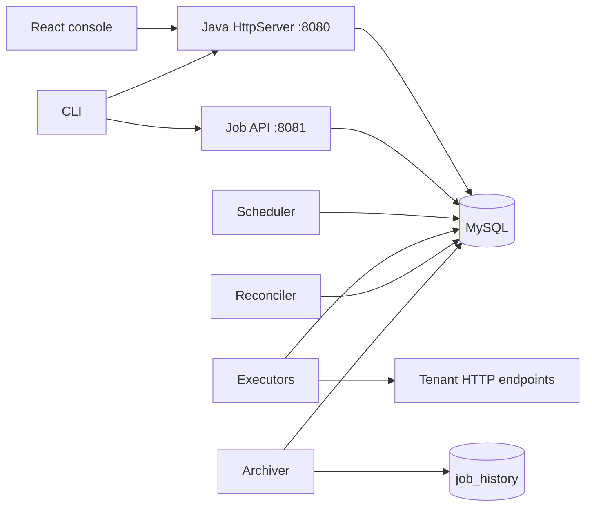

# Chroner

**Chroner is a multi-tenant cron and HTTP job scheduler.** Tell it to call an
endpoint now, at a date, or on a cron expression. It adds priorities, retries,
leases, a dead letter queue, and a queryable history of every run.

The defining choice is simple: **there is no message broker.** The queue is a
MySQL table. A job is written before it can run, so the database and a queue
can never disagree.

```text
Tenant -> task (configuration) -> jobs (queue) -> executor -> HTTP endpoint
                                      |
                                      +-> retries -> DLQ
                                      +-> history
```

## Why no broker?

Saving a job in a database and publishing it to Kafka or RabbitMQ is a **dual
write**. If one side fails, they disagree forever. Chroner has one write.

- **Claim with `FOR UPDATE SKIP LOCKED`.** Executors take different rows and
  never wait for each other.
- **The lease is a column.** No Redis lock can disagree with the job row.
- **`attempt` is a fencing token.** Every claim increments it, and every result
  write checks it, so a late executor cannot overwrite a newer owner.
- **Nothing is dropped.** A failed call ends in `pending` (retry) or `dead`
  (DLQ), never in a silent loss.

## Features

- **Schedules:** run now, once at a timestamp, or on a five-field cron
  expression in any IANA timezone.
- **Priorities:** `critical`, `high`, `normal`, `low`, with an anti-starvation
  lane so low-priority work still runs.
- **Retries:** exponential backoff (`backoff_ms * 2^(attempt-1)`, capped at one
  hour) and a DLQ with manual retry.
- **Durable queue:** MySQL `jobs` table, claimed with `SKIP LOCKED`.
- **Leases and fencing:** a dead executor is recovered by the reconciler; late
  writes affect zero rows.
- **History:** finished jobs move to `job_history`; the hot row is deleted only
  after history is written.
- **Multi-tenant:** the tenant comes from the JWT `sub` claim.
- **Login:** seeded users in MySQL, PBKDF2-HMAC-SHA256 password hashes, and the
  same HS256 JWT used by the CLI.
- **Secret handling:** request headers and body are AES-256-GCM at rest and are
  never returned by the API, logged, or archived.
- **Idempotent task creation:** `(tenant_id, Idempotency-Key)` is unique.
- **Edit safety:** a job copies its task's request at plan time; editing a task
  never changes a job that already exists.
- **SSRF guard:** only public addresses, only ports 80/443, no proxy, no
  redirects.
- **Web console:** React + TypeScript + Tailwind + React Router, served by the
  Java process.

## Architecture



One JVM can run every role (`all`), or one role at a time (`scheduler`,
`executor`, `reconciler`, `archiver`, `task-api`, `job-api`, `echo`). The JSON
API and the React console share port `8080`, so there is no CORS and no Node
process in production.

## Quick start

Requirements: Docker with Compose v2, and Java 17 + Maven for the CLI or local
runs.

```bash
cp .env.example .env

docker compose up -d --build
```

Open **http://localhost:8080** and sign in:

```text
Tenant:   acme
Username: admin
Password: admin123
```

The demo user is seeded by `deploy/mysql/schema.sql`. Change the password before
sharing a deployment.

The CLI is optional:

```bash
mvn package
export JWT_SECRET=dev-only-jwt-secret-change-me
export CHRONER_TOKEN=$(java -jar target/chroner-1.0.jar cli token acme)
```

Create a task:

```bash
java -jar target/chroner-1.0.jar cli task create \
  -name hello \
  -url http://echo/hello \
  -priority critical

java -jar target/chroner-1.0.jar cli task list
java -jar target/chroner-1.0.jar cli job dlq
```

The demo `echo` service is available from the app at `http://echo/...` and on
the host at `http://localhost:8083`.

Useful demo endpoints:

| Path | Behaviour |
|---|---|
| `/hello` | 200 `ok` |
| `/flaky` | 503 on attempt 1, 200 on attempt 2 |
| `/fail` | always 500, useful for the DLQ |
| `/slow?ms=3000` | waits, then returns 200 |

## Web console

| Page | What it does |
|---|---|
| `/login` | tenant, username, password |
| `/` | task and DLQ counts, recent tasks |
| `/tasks` | list, edit, pause, resume, delete |
| `/tasks/new` | create now / at / cron, priority, timeout, retry, headers, body |
| `/tasks/:id/edit` | edit configuration; preserve or replace encrypted secrets |
| `/tasks/:id` | configuration and execution history, retry dead jobs |
| `/dlq` | dead jobs and manual retry |

The browser stores the JWT in `localStorage`. Protected pages redirect to
`/login` when the token is missing or expired. The API uses the same token.

Editing never exposes stored headers or body. The edit form keeps them unless
you uncheck **Keep the existing encrypted headers and body**.

## API

All routes except `GET /healthz` and `POST /auth/login` require:

```http
Authorization: Bearer <HS256 JWT>
```

The tenant is the token's `sub` claim.

### Login

```http
POST /auth/login
Content-Type: application/json

{"tenant": "acme", "username": "admin", "password": "admin123"}
```

Response:

```json
{
  "token": "eyJ...",
  "tenant_id": "acme",
  "username": "admin",
  "expires_at": "2026-11-20T06:48:25Z"
}
```

Wrong credentials return `401` with a generic message.

### Tasks

| Method and path | Description |
|---|---|
| `POST /tasks` | create; optional `Idempotency-Key` header |
| `GET /tasks` | list up to 500 tasks |
| `GET /tasks/{id}` | one task |
| `PUT /tasks/{id}` | full replace; optional `preserve_secrets` |
| `POST /tasks/{id}/pause` | stop planning new jobs |
| `POST /tasks/{id}/resume` | resume; cron restarts from now |
| `DELETE /tasks/{id}` | soft delete |

Example:

```json
{
  "name": "daily-report",
  "cron": "0 9 * * *",
  "timezone": "Europe/Madrid",
  "priority": "high",
  "request": {
    "method": "POST",
    "url": "https://api.example.com/run",
    "headers": {"Authorization": "Bearer ..."},
    "body": "{}"
  },
  "timeout_ms": 10000,
  "retry": {"max_attempts": 3, "backoff_ms": 1000}
}
```

Use `"at": "2026-12-01T09:00:00Z"` for a one-shot task, or omit both `cron`
and `at` to run now.

To edit without touching stored secrets:

```json
{
  "name": "daily-report",
  "timezone": "Europe/Madrid",
  "priority": "critical",
  "request": {"method": "POST", "url": "https://api.example.com/run"},
  "timeout_ms": 10000,
  "retry": {"max_attempts": 3, "backoff_ms": 1000},
  "preserve_secrets": true
}
```

### Jobs and DLQ

| Method and path | Description |
|---|---|
| `GET /jobs/{id}` | job status, hot or archived |
| `POST /jobs/{id}/retry` | return a dead job to pending with one more attempt |
| `GET /tasks/{id}/jobs?limit=n` | merged hot + archived history |
| `GET /dlq` | up to 500 dead jobs |
| `GET /healthz` | health check, no auth |

`limit` defaults to 50; values ≤ 0 or > 500 become 50.

## CLI

```text
chroner token <tenant>

chroner task create [flags]
chroner task update <id> [flags]
chroner task list
chroner task get|pause|resume|delete <id>

chroner job get <id>
chroner job history <task-id> [-limit n]
chroner job dlq
chroner job retry <id>
```

Create/update flags:

```text
-name <name>                 required
-url <url>                   required
-method <method>             default POST
-body <json>
-header "Name: value"        repeatable
-cron "<expr>"               optional
-at <RFC3339>                optional
-tz <zone>                   default UTC
-priority <p>                default normal
-timeout-ms <n>              default 10000
-max-attempts <n>            default 3
-backoff-ms <n>              default 1000
-idempotency-key <key>
```

The CLI reads `CHRONER_TOKEN`, `CHRONER_TASK_API`, and `CHRONER_JOB_API`.

## Configuration

| Variable | Default | Used by |
|---|---|---|
| `MYSQL_URL` | `jdbc:mysql://localhost:3306/chroner?...` | all database roles |
| `MYSQL_USER` | `chroner` | database |
| `MYSQL_PASSWORD` | `chroner-dev-only` | database |
| `SECRETS_KEY` | required; base64 of 32 bytes | all except echo |
| `JWT_SECRET` | required for APIs/login | task-api, job-api, CLI |
| `AUTH_TOKEN_TTL_SECONDS` | `86400` | login |
| `TASK_API_PORT` | `8080` | task-api / console |
| `JOB_API_PORT` | `8081` | job-api |
| `ECHO_PORT` | `8083` | echo |
| `WEB_ROOT` | `frontend/dist` | console |
| `SCHEDULER_INTERVAL_MS` | `5000` | scheduler |
| `SCHEDULER_LOOKAHEAD_MS` | `30000` | scheduler |
| `SCHEDULER_BATCH` | `500` | scheduler |
| `EXECUTOR_WORKERS` | `64` | executor |
| `EXECUTOR_POLL_MS` | `500` | executor |
| `WORKER_ID` | hostname + pid | executor |
| `EXECUTOR_ALLOW_CIDRS` | empty | executor, **dev only** |
| `RECONCILER_INTERVAL_MS` | `5000` | reconciler |
| `RECONCILER_BATCH` | `1000` | reconciler |
| `ARCHIVER_INTERVAL_MS` | `10000` | archiver |
| `ARCHIVER_BATCH` | `500` | archiver |
| `ARCHIVE_SUCCEEDED_AFTER_MINUTES` | `60` | archiver |
| `ARCHIVE_DEAD_AFTER_HOURS` | `336` | archiver |
| `HISTORY_TTL_DAYS` | `30` | archiver |

`docker compose` reads secrets from `.env`. For local runs, export them in your
shell.

## Local development

Backend:

```bash
mvn test
mvn package
java -jar target/chroner-1.0.jar all
```

Frontend:

```bash
cd frontend
npm install
npm run dev
```

Vite runs on `http://localhost:5173` and proxies `/tasks`, `/jobs`, `/dlq`,
`/auth`, and `/healthz` to `http://localhost:8080`.

Production-style local run:

```bash
cd frontend && npm run build && cd ..
WEB_ROOT=frontend/dist java -jar target/chroner-1.0.jar all
```

The Dockerfile builds the React bundle in a Node stage and the JAR in a Maven
stage, then copies both into a JRE image.

## Testing

```bash
mvn test
```

Unit tests need no database. They cover task validation, cron/timezone/DST,
retry state transitions, backoff, fair tenant picking, JWT, SSRF, AES-GCM, and
password hashing.

The MySQL integration test is skipped by default:

```bash
RUN_DB_TESTS=1 \
MYSQL_URL='jdbc:mysql://localhost:3306/chroner_test?useSSL=false&allowPublicKeyRetrieval=true&connectionTimeZone=UTC&forceConnectionTimeZoneToSession=true' \
MYSQL_USER=chroner MYSQL_PASSWORD=chroner-dev-only \
SECRETS_KEY='ZGV2LW9ubHktc2VjcmV0cy1rZXktMzItYnl0ZXMhISE=' \
mvn test
```

It covers idempotent creation, claim/fencing/archive, disjoint concurrent
claims, lease expiry, and secret preservation during edits. The frontend is
checked with:

```bash
cd frontend
npm run build
```

## Project layout

```text
pom.xml                          Maven build
Dockerfile                       Node + Maven + JRE stages
docker-compose.yml               MySQL, app, echo
deploy/mysql/schema.sql          tables, indexes, demo login
src/main/java/com/example/chroner/
  Main.java                      modes, wiring, shutdown
  config/Config.java             environment variables
  domain/                        task, job, priorities, cron, backoff, fair pick
  db/                            JDBC stores, AES-GCM, users, history
  services/                      task/job/auth services, four loops, password hashing
  security/Jwt.java              HS256
  http/                          Json, Router, TaskApi, JobApi, AuthApi, WebUi
  call/                          HTTP caller, SSRF guard, CIDR
  cli/                           CLI client
src/test/java/com/example/chroner/
frontend/
  src/pages/                     login, overview, tasks, create/edit, detail, DLQ
  src/components/                layout, badges
  src/api.ts                     fetch client and session
  src/types.ts                   API types
```

## Design notes

### The job lifecycle

1. The scheduler finds active tasks due within the next 30 seconds and, in one
   transaction, inserts pending jobs and advances `next_run_at`.
2. An executor claims due jobs with `FOR UPDATE SKIP LOCKED`, increments
   `attempt`, sets its `worker_id` and lease, and **commits before the HTTP
   call**.
3. Each job waits on its own in-memory timer, then calls the endpoint with
   `Idempotency-Key`, `X-Scheduled-At`, and `X-Attempt`.
4. The result is saved only if `id + status = 'running' + worker_id + attempt`
   still matches. A 2xx becomes `succeeded`; anything else becomes `pending`
   with backoff or `dead` after the last attempt.
5. If the executor dies, the reconciler returns the expired lease to
   `pending`, or to `dead` when attempts are exhausted.
6. After the retention window, the archiver writes to `job_history` first and
   then deletes the hot row.

### Guarantees

- **An accepted task is not lost.** The API responds only after the commit.
- **At-least-once delivery.** A timeout may still have reached the endpoint;
  the stable idempotency key is how the receiver deduplicates.
- **Late writes cannot corrupt a job.** `attempt` fences every result write.
- **Low priority does not starve.** About 10% of each claim batch comes from
  the oldest-due lane, ignoring priority.
- **Tenant fairness.** Each claim batch gives tenants an equal share first, then
  fills unused slots.
- **Secrets stay secret.** Headers/body are AES-GCM at rest, excluded from JSON,
  logs, and history.
- **History is safe.** It is written before the hot row is deleted.

### Deliberate limits

- History is a MySQL table, not Cassandra. This keeps the course demo to one
  database; `HistoryStore` is the seam if that changes.
- SSRF is checked immediately before the request. Java's built-in
  `HttpClient` has no dialer hook, so a DNS-rebinding gap remains and is
  documented in `impl.doc`.
- The executor opens one JDBC connection per operation. Add HikariCP if a
  deployment needs a pool.
- One MySQL primary is a course-scale limit; the queue can be sharded later.
- The JWT is kept in `localStorage` for this local console. A production
  deployment should use a hardened session strategy.

## Stop or reset

```bash
docker compose down       # stop, keep the database volume
docker compose down -v    # stop and wipe local data
```

## Documentation

- `impl.doc` — detailed design, data model, API, security, and test plan
- `AGENTS.md` — repository rules and conventions
